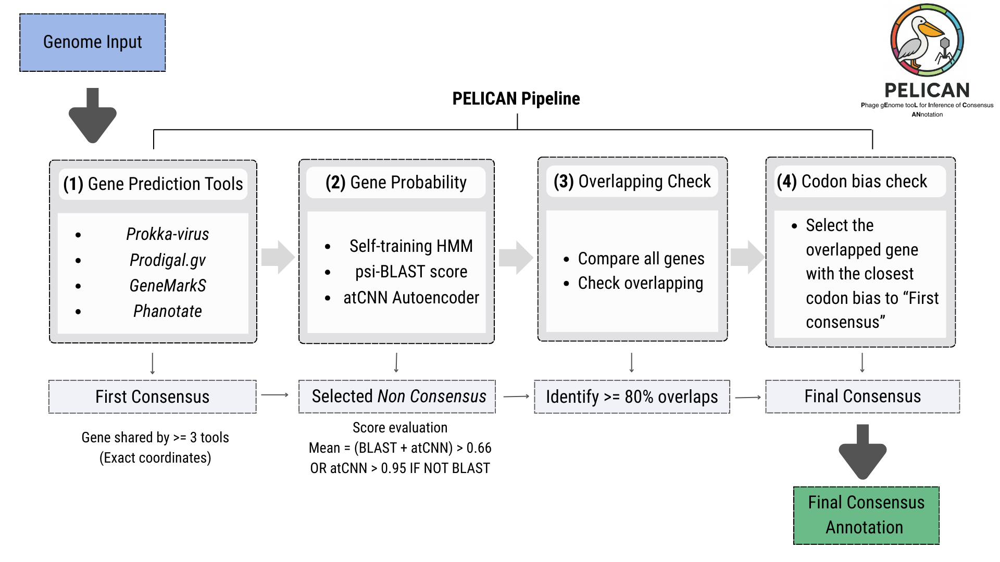

# PELICAN
## Phage gEnome tooL for Inference of Consensus ANnotation

PELICAN is a Machine Learning based tool for automated genome consensus annotation. It runs four gene prediction tools:  
1. Phanotate
2. Prokka-virus
3. prodigalGV
4. GeneMarkS

And from those find the best combination of genes predicted by each tool.  

### Pipeline



1. Gene prediction using all annotation tools.
2. Extracting gene coordinates from the output of each tool.
3. Finding shared genes predicted by at least three of the four tools -- **First consensus**
4. All genes from the **First consensus** are evaluated to calculate the mean codon usage
5. The non-consensus genes are compared to the PHROGS and COGs databases to calculate a BLAST score.
6. The same non-consensus genes are processed by an AutoEncoder (atCNN) to predict if they "look like" phage genes or not.
7. The means score between BLAST and atCNN must exceed 0.66. Otherwise, if only atCNN, the score must exceed 0.95.
8. Finally, all genes are evaluated to check for overlaps higher than 80% of the gene length. If the overlap is significant, both overlapping genes have their codon usage calculated and compared to the **First consensus**. The gene with the closer codon usage is then selected.

## Installation

Requirements: Linux x86-64, [conda](https://docs.conda.io/en/latest/miniconda.html) (or mamba) and about **15 GB of free disk space**
(the conda environment takes ~4 GB and the COG/PHROG BLAST database built by `pelican-setup` takes ~10 GB).
No `sudo`, podman or docker is needed.

```bash
git clone https://github.com/LaboratorioBioinformatica/PELICAN.git
cd PELICAN
conda env create -f environment.yml   # or: mamba env create -f environment.yml
conda activate pelican
pelican-setup
```

`pelican-setup` is run once. It:
- checks that all external tools are available (Prokka, Aragorn, BLAST+, Phanotate, perl, wget);
- tests GeneMarkS on a small reference genome;
- downloads the COG database and builds the BLAST database (PHROGs + COGs);
- downloads the DNABERT-6 model from HuggingFace.

It prints `OK`/`FAIL` for each item, with instructions on how to fix any failure.

### GeneMark license key

GeneMarkS requires a free license key, and **GeneMark keys expire after 400 days**.
If `pelican-setup` reports that the key has expired:

1. Download a key at <https://exon.gatech.edu/GeneMark/license_download.cgi>
   (select GeneMarkS, LINUX 64, and download the key file `gm_key_64.gz`).
2. Install it:
   ```bash
   pelican-setup --gm-key /path/to/gm_key_64.gz
   ```
   (this copies the key to `~/.gm_key`, the standard GeneMark location).

You can also point to a key with the `PELICAN_GM_KEY` environment variable.

### Quick test

```bash
pelican -i pelican/test_data/NC_010325.1.fasta --output_path test_run
```

## Usage

After installation, you can use PELICAN from anywhere:

```bash
pelican -i your_genome.fasta --output_path ./results
```

### Command-line options

```bash
  -h, --help            show this help message and exit
  -i INPUT, --input INPUT
                        Phage genome in fasta format
  --consensus CONSENSUS
                        Number of tools for initial consensus -- default: 3
  --ident IDENT         minimun identity for blast search (psiblast) -- default: 30
  --cov COV             minimun coverage for blast search (psiblast) -- default: 40
  --output_path OUTPUT_PATH
                        Path fot output folder -- Default: uses current directory
  --version             Show version information
  --create_gff          Create GFF files from predictions
  --create_blastdb      Create BLAST database
  --fill                Force filling of missing genes empty coordinates
  --threads THREADS     Number of threads to use -- default: 4
```

### pelican-setup options

```bash
  --gm-key GM_KEY   GeneMark license key file (gm_key_64.gz or plain) to install as ~/.gm_key
  --check-only      Only check tools and GeneMarkS; do not download anything
  --skip-db         Do not prepare the BLAST database
  --skip-dnabert    Do not download the DNABERT-6 model
```

## How GeneMarkS is executed

PELICAN uses GeneMarkS 4.32 (`gmsn.pl --phage`). The GeneMarkS binaries are shipped with PELICAN and run
directly on Linux x86-64 (**native** backend). These are the same binaries contained in the original container
image, and they produce identical predictions.

A container is only needed on systems where the native binaries cannot run. The backend is selected
with the `PELICAN_GENEMARK_BACKEND` environment variable:

| Value | Behavior |
|---|---|
| `auto` (default) | try `native`, then `podman`, then `docker` |
| `native` | run the bundled binaries with the local perl |
| `podman` | run the bundled container image with podman |
| `docker` | run the bundled container image with docker |

The container image (`pelican/genemarks/podman_genemarks/genemark_image.tar.gz`) is imported automatically on first use.

## Troubleshooting

**GeneMarkS failed (`Error on GeneMarkS`, followed by `UnboundLocalError: ... tmp_genemarks_GBK`).**
Check `tmp_dir/genemark_execution.log` in the output folder and run `pelican-setup --check-only`.
The most common cause is an expired license key (see [GeneMark license key](#genemark-license-key)).

**Offline machines or HPC clusters.**
Run `pelican-setup` once on a machine with internet access. The DNABERT-6 model is stored in the
HuggingFace cache (`~/.cache/huggingface`, or the folder set by `HF_HOME`); copy it to the offline machine
and set `HF_HOME` accordingly. If HuggingFace requires authentication, set `HF_TOKEN`.

**"database folder is not writable".**
PELICAN creates its BLAST database inside the installed package folder. Install PELICAN in an environment
owned by your user (such as the conda environment above), not in a system-wide Python.

**macOS / ARM machines.**
The native GeneMarkS binaries require Linux x86-64. On other systems, use `PELICAN_GENEMARK_BACKEND=podman`
(with `podman machine`) or `docker`; the image is x86-64, so it runs under emulation.

**Podman error: `OCI runtime error: crun: unknown version specified`** (podman backend only).
```bash
sudo apt install -y runc

mkdir -p ~/.config/containers
cat > ~/.config/containers/containers.conf << 'EOF'
[engine]
runtime = "runc"
EOF
```

## Reproducing the paper environment

`environment.yml` contains only what PELICAN needs. The exact environment used for the paper is available in
[envs/PELICAN_paper.yml](envs/PELICAN_paper.yml) (conda) and [envs/paper_pip_freeze.txt](envs/paper_pip_freeze.txt) (pip).

## Test data and pre-run outputs

Test genomes are available in the folder [test_data](pelican/test_data).  
For the same test genomes, pre-run results are available in the folder [test_results](pelican/test_data/test_results).


## Citation

```latex
@article{rossi2026pelican,
  author  = {Rossi, Fernando P. N. and Uceda-Campos, Guillermo and
             Cardoso, Guilherme Wenceslau de Lima and
             Franco, Pedro Rossi de Andrade and Setubal, Jo{\~a}o Carlos},
  title   = {{PELICAN}: A New Bacteriophage Genome Annotation Tool},
  journal = {BMC Bioinformatics},
  year    = {2026},
  month   = oct,
  note    = {Ahead of print, published online 22 October 2026},
  doi     = {10.1186/s12859-026-06703-w},
  url     = {https://doi.org/10.1186/s12859-026-06703-w}
}
```

Rossi, Fernando P. N., Guillermo Uceda-Campos, Guilherme Wenceslau de Lima Cardoso, Pedro Rossi de Andrade Franco, and João Carlos Setubal. 2026. “PELICAN: A New Bacteriophage Genome Annotation Tool.” BMC Bioinformatics, ahead of print, October 22. https://doi.org/10.1186/s12859-026-06703-w.
